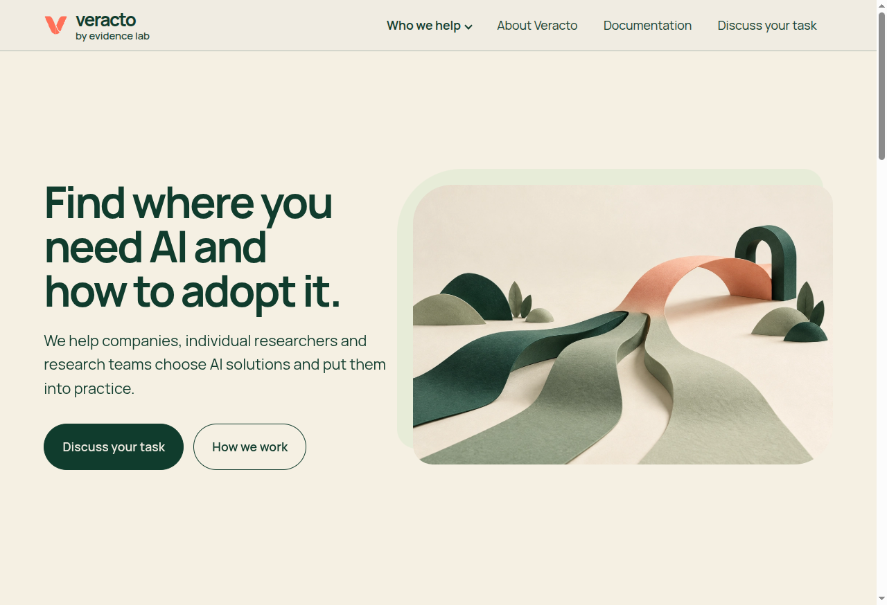

# Veracto — Consulting Website Case Study

A bilingual website for an AI consulting practice, designed around three audiences: companies, individual researchers and research teams. Each route explains how Veracto can help and gives visitors a clear next step.

**My role:** As Veracto co-founder, I worked on the product and delivery of the site. [Explore the bilingual preview](https://veracto.github.io/veracto-site-showcase/) · [Read the case study](docs/case-study.md).



The wider project includes other co-founders, advisors and experts; the people shown in the site retain their own roles and authorship.

## Explore

- [Bilingual portfolio preview](https://veracto.github.io/veracto-site-showcase/)
- [Original business website](https://veracto.ai/)
- [Product decisions](docs/case-study.md)
- [Verification](docs/verification.md)

The site helps companies, individual researchers and research teams understand where AI consulting may help and what a next conversation involves. It distinguishes evaluation, adoption support and training.

## Implementation

Astro owns static routes and page composition; typed content modules own copy; shared CSS tokens and native browser code own presentation and bounded interaction. The selected original application source preserves both Russian and English. Case documentation is English. The static preview disables analytics controls at the packaging stage; original source files are unchanged. Private portrait originals/review masters, CRM and client records are excluded.

## Run locally

Verified toolchain: Node.js 26.9, npm 11+ and Python 3.

```sh
npm ci
npm run quality
npm run dev -- --host 127.0.0.1
```

`quality` checks Astro/TypeScript, lint, the static build, both locale outputs and local asset references. This edition omits the private production deployment harness; browser verification is recorded separately.

## Scope of the case

The evidence is the delivered interface, source structure and checked behavior. Commercial demand, conversion improvement, revenue and client impact are not inferred from publishing a website. This public edition does not deploy changes to the original business website.

See [NOTICE](NOTICE.md) for authorship, project assets and dependencies.
